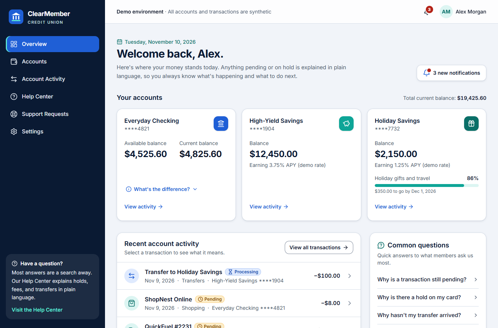
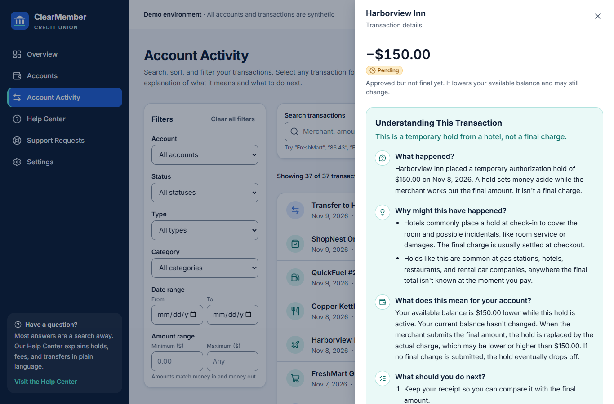
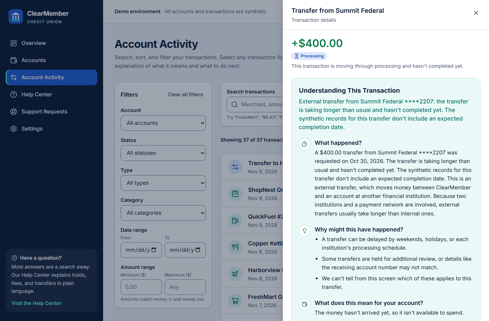
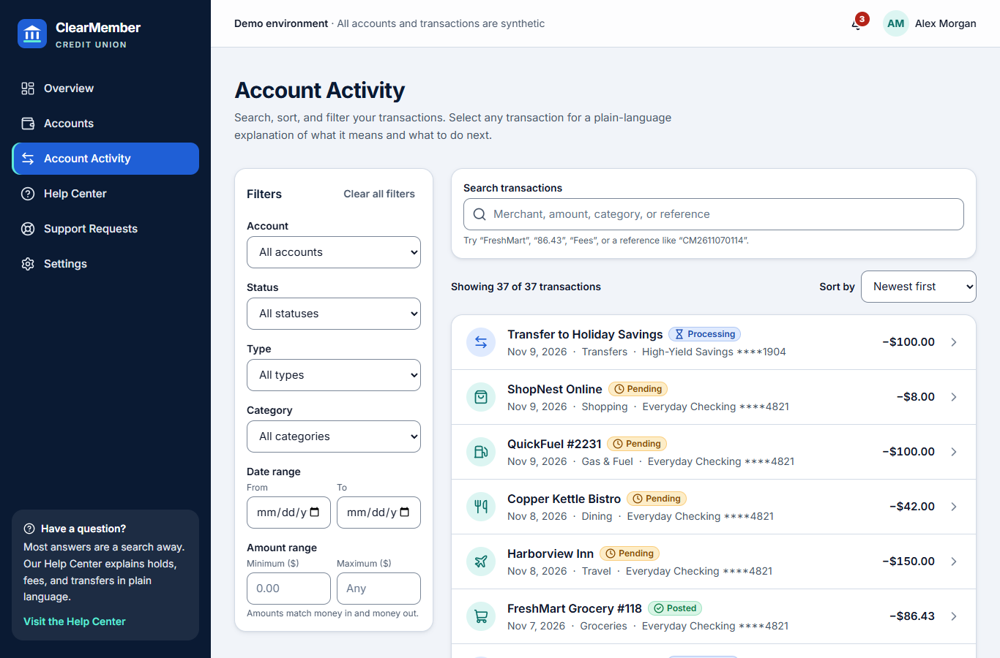
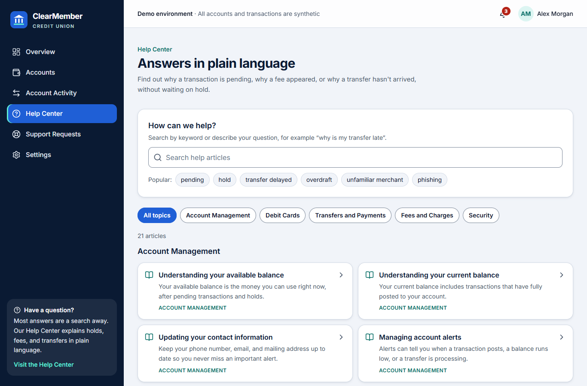
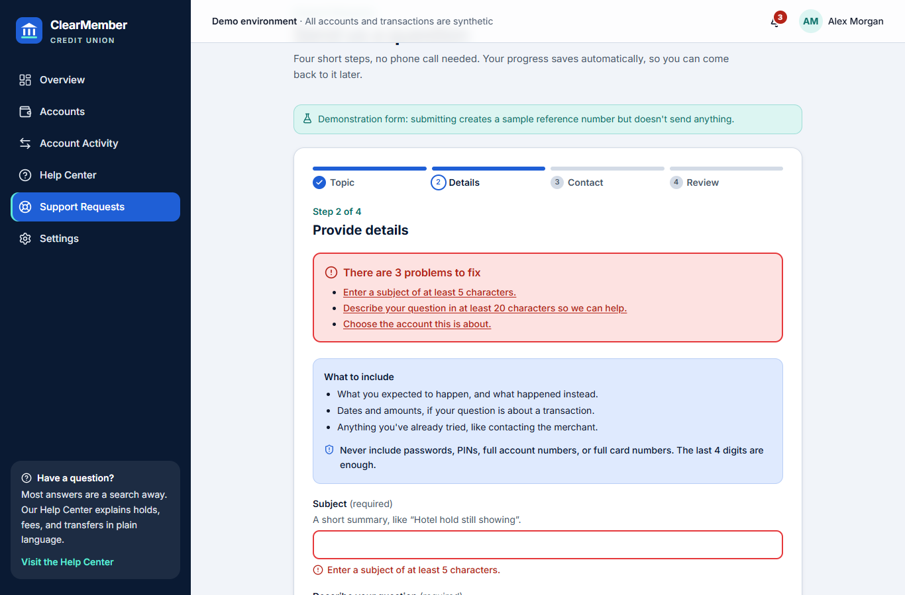
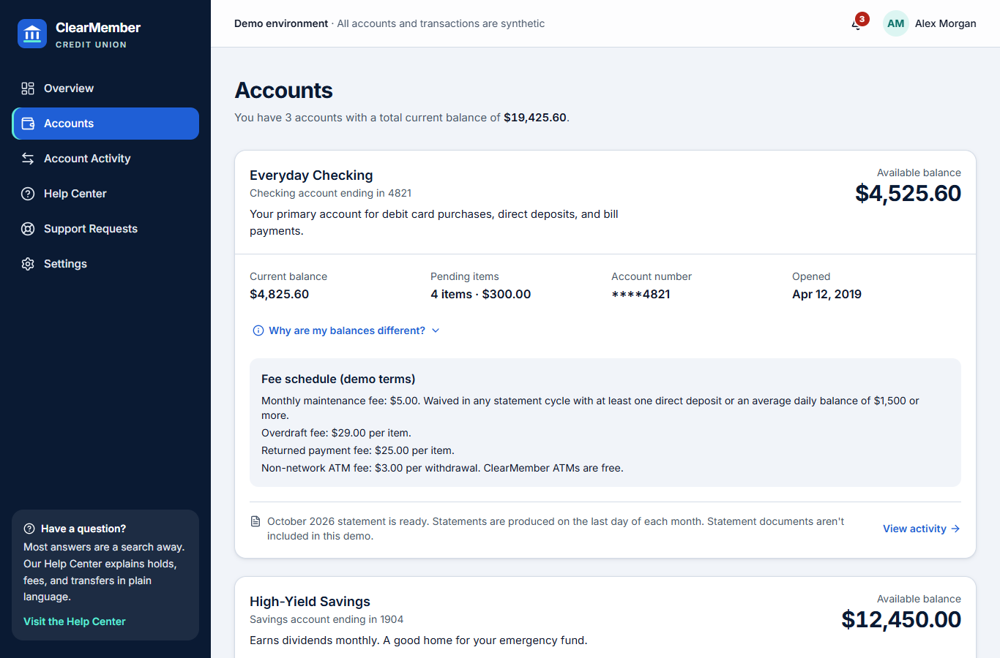
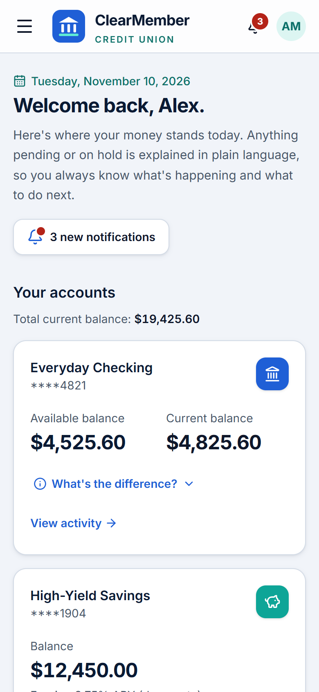
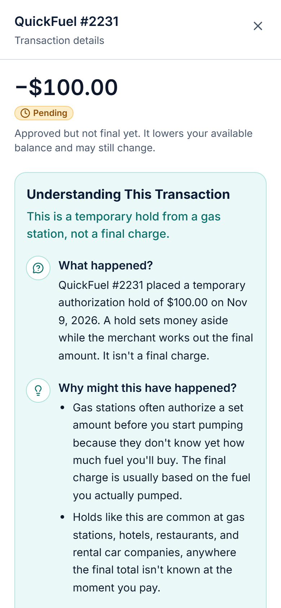

# Clear Member Credit Union – Member Banking Dashboard

**All financial data in this project are synthetic.** See the [disclaimer](#disclaimer).

## Do not just display banking information. Explain it.

A member-centered digital banking dashboard for a fictional credit union. Members can search and filter their activity, and every transaction comes with a plain-language explanation. The app also includes a searchable Help Center and an accessible four-step support request that saves drafts automatically.

## Clear Member Credit Union Screenshot




## 🛠️ Tech Stack

* Next.js 16: App Router, React 19
* TypeScript: strict typing throughout
* Tailwind CSS v4: accessible, high-contrast design tokens
* React Hook Form + Zod: validated multi-step forms
* Vitest: fast unit testing
* React Testing Library: user-focused, accessible component tests
* Lucide React: consistent icon set
* localStorage: versioned, debounced draft saving
* ESLint: Next.js and TypeScript rules
* GitHub Actions: CI for lint, tests, build
* Vercel: automated production deployment
* Lighthouse + axe-core: performance and accessibility audits

### 🚀 Key Features

* 💡 Plain-language transaction explanations: what happened, why, and what to do next
* ⚖️ Balance breakdown: shows exactly why available and current balances differ
* 🔍 Smart transaction search: by merchant, amount, category, or reference
* 🎛️ Combinable filters: account, date, status, type, category, and amount
* ⛽ Hold explanations: gas stations, hotels, restaurants, and rental cars
* 🔁 Transfer tracking: a stage-by-stage timeline that never promises delivery dates
* 💸 Fee explanations: overdraft, ATM, maintenance, and returned payment fees
* ❓ Unfamiliar merchant guidance: decodes confusing statement names, with safe-contact tips
* 📚 Searchable Help Center: 21 articles that understand natural-language questions
* 📝 Accessible four-step support form: validated with React Hook Form and Zod
* 🛡️ Sensitive data protection: blocks full card numbers, passwords, and PINs
* 💾 Autosaved drafts: restores your progress, even after closing the browser
* ♿ Accessibility first: 0 axe violations, Lighthouse Accessibility 100
* ✅ 83 automated tests: Vitest and React Testing Library
* 🚀 CI/CD: GitHub Actions tests every push, then deploys to Vercel
* 🧪 100% synthetic data: no real accounts or banking connections

## Clear Member Credit Union

🔗 **Live Demo:** [View Live Website](https://clearmember-credit-union.vercel.app)

A Next.js banking dashboard that explains every transaction in plain language.

## Summarist Book Summary Run Instructions

## Table of contents

1. [Project overview](#project-overview)
2. [Problem statement](#problem-statement)
3. [Inspiration and real-world motivation](#inspiration-and-real-world-motivation)
4. [Key features](#key-features)
5. [Technology stack](#technology-stack)
6. [Screenshots](#screenshots)
7. [Project structure](#project-structure)
8. [Installation](#installation)
9. [Environment setup](#environment-setup)
10. [Development](#development)
11. [Testing](#testing)
12. [Linting](#linting)
13. [Production build](#production-build)
14. [Continuous integration](#continuous-integration-github-actions)
15. [Lighthouse audit results](#lighthouse-audit-results)
16. [axe accessibility audit results](#axe-accessibility-audit-results)
17. [Future improvements](#future-improvements)
18. [Disclaimer](#disclaimer)

---

## Project overview

ClearMember is a working Next.js application, not a static mockup. Every control on screen does something:

- **Overview:** account balances, a breakdown of *why* available and current balances differ, recent activity, and answers to common questions.
- **Accounts:** balances, account details, and the (synthetic) fee schedule for each account.
- **Account Activity:** live search across merchant, description, amount, category, and reference number, with six combinable filters and four sort orders.
- **Transaction explanations:** select any transaction to open a detail panel. Its *Understanding This Transaction* section answers four questions in plain language.
- **Help Center:** 21 searchable articles in five categories, linked to and from transaction explanations.
- **Support Requests:** a four-step form built with React Hook Form and Zod. It saves drafts to `localStorage` automatically and handles corrupted or outdated drafts gracefully.
- **Notifications and Settings:** a notification panel with read and unread states, plus alert preferences saved in the browser.

## Problem statement

Banking apps are good at showing numbers and bad at explaining them. A member sees `PENDING −$100.00 QUICKFUEL 2231 PAY@PUMP` and their available balance drop, but nothing tells them it's a temporary hold that will likely shrink to the actual pump total. So they call.

Many contact-center calls are not really problems. They are explanations nobody gave:

- Why is this transaction still pending?
- Why is my available balance lower than my current balance?
- Why is there a hold on my debit card?
- Why hasn't my transfer arrived?
- Why was I charged this fee?
- I don't recognize this merchant name. Is it fraud?
- Where do I find this transaction, and how do I ask about it without calling?

ClearMember answers each of these where the member is already looking.

## Inspiration and real-world motivation

This project comes from two years of answering member questions in a credit union contact center. The same handful of questions came up every day, and they usually had calm, simple answers that the digital experience never offered.

The design decisions trace back to that experience:

| What members asked on the phone | What ClearMember does |
| --- | --- |
| "Why do I have less money than my balance says?" | Shows both balances and lists the exact pending items behind the $300.00 difference. |
| "There's a $100 charge from a gas station, but I only pumped $40." | Identifies the transaction as a temporary fuel hold and explains that the final amount may differ. |
| "My transfer is late." | Shows a transfer timeline (Initiated → Processing → Completed / Delayed) and explains why timing varies, **without inventing a delivery date**. |
| "What is CPX\*MRNGSDE CAFE?" | Explains payment-processor descriptors, suggests the possible business as a *starting point, not a confirmation*, and gives safe-contact guidance. |
| "Why was I charged a fee?" | Explains the fee in plain language, cites the account's (demo) fee terms, and links the related transaction that triggered it. |
| "Can I just send you a message?" | Provides a four-step support request that pre-fills from the transaction and never asks for passwords, PINs, or full account numbers. |

Two rules shaped all of the explanation copy:

1. **Never claim certainty the data doesn't support.** Explanations use "may," "often," and "commonly," and say things like "We can't confirm the exact reason from this screen."
2. **Always end with a next step.** Every explanation answers *What happened? Why might this have happened? What does this mean for your account? What should you do next?*

## Key features

### 🏠 Account overview
- 👋 Welcome section with the current date (from the visitor's browser) and a notification indicator.
- 🏦 Three synthetic accounts: Everyday Checking (\*\*\*\*4821), High-Yield Savings (\*\*\*\*1904), and Holiday Savings (\*\*\*\*7732).
- ⚖️ A "What's the difference?" disclosure explaining current versus available balance. It lists the four pending items (two holds, a pending restaurant charge, and an online order) that add up to exactly the $300.00 difference.
- 🧾 Recent activity with category icons, status badges (icon plus text, never color alone), signed amounts, and screen-reader text for money in and money out.

### 🔍 Transaction search and filtering
- 🔎 **Search** by merchant, descriptor, description, category, reference number, or amount (`86.43`, `$212.45`). Every word in a query must match.
- 🎛️ **Filters:** account, date range, status (Posted, Pending, Processing, Reversed), type (Deposits, Withdrawals, Purchases, Transfers, Fees), category, and amount range. All filters combine.
- 🔢 Result count announced to screen readers, removable filter chips, **Clear all filters**, a range validation message, and an empty state with recovery actions.
- ↕️ **Sorting:** newest, oldest, highest amount, and lowest amount.
- 🔗 Deep links such as `/activity?status=pending` or `/activity?txn=txn-1018`, used by notifications, articles, and support history.

### 💡 Interactive transaction explanations (signature feature)
A pure, unit-tested explanation engine in [`lib/transaction-explanations.ts`](lib/transaction-explanations.ts) chooses a scenario from the transaction's data:

| Scenario | Example in the demo data |
| --- | --- |
| ⏳ Pending authorization | ShopNest Online, $8.00 |
| ⛽ Authorization holds: fuel, hotel, restaurant, rental car (active or released) | QuickFuel $100 hold, Harborview Inn $150 hold, Swiftway released $350 hold → $212.45 final |
| 🔁 Transfers: internal and external, with Initiated, Processing, Completed, and Delayed stages | Summit Federal transfer (Delayed) with a full timeline |
| 💸 Fees: monthly maintenance, overdraft, ATM, and returned payment | Each linked to its related transaction |
| ❓ Unfamiliar merchant descriptors: processor, parent company, shortened name, billing location | `CPX*MRNGSDE CAFE`, `BLUEHARBOR HOLDINGS LLC` |
| ↩️ Reversed transactions, deposits and dividends, and posted purchases | Peakwear (canceled), payroll, dividends |

🪟 The detail panel is an accessible dialog: it traps focus, closes with Escape, and returns focus to the row that opened it. It shows every transaction field, the four-part explanation, a safety note for possibly unauthorized activity, related transactions, related Help Center articles, and three actions: **View related transactions**, **Visit the Help Center**, and **Submit a support request**. The last one pre-fills the form with the topic, account, and transaction.

### 📚 Searchable Help Center
- 📖 21 articles across Account Management, Debit Cards, Transfers and Payments, Fees and Charges, and Security.
- 🧠 Ranked keyword search that ignores filler words ("why is my transfer late" finds *Why an external transfer may be delayed*) and handles simple plurals and past tense.
- 🏷️ Category filters, suggested searches, and an empty state that offers a support request.
- 🧭 Each article has a summary, a plain-language body, next steps, related articles, a link into the member's own matching transactions, and a pre-filled support request link.

### 📝 Accessible four-step support request
1. 🗂️ **Topic:** eight topics, shown as radio cards.
2. ✍️ **Details:** subject, description (with a character count), account, and an optional transaction picker built from the synthetic activity. Validation **rejects anything that looks like a full card or account number, password, or PIN**.
3. 📞 **Contact preferences:** secure message, email, or phone, with conditional validation, plus a preferred time.
4. ✅ **Review and submit:** every answer, with an *Edit* button for each section.

♿ Accessibility details: a visible label and a "(required)" or "(optional)" marker on every field, errors linked with `aria-describedby` and `aria-invalid`, an error summary that receives focus and links to each field, focus moving to the step heading on navigation, a progress indicator with `aria-current="step"`, and error icons with "Error:" prefixes so meaning never depends on color.

🎫 On submit, the form generates a synthetic reference number (`CM-SR-YYYYMMDD-NNNN`) and clearly states that **no ticket was transmitted**.

### 💾 Local draft saving
[`hooks/useLocalDraft.ts`](hooks/useLocalDraft.ts) provides:
- ⏱️ Autosave debounced to 800 ms, plus an immediate save when the member changes steps or presses **Save draft**.
- 🔄 Restoring values *and the current step* on return, with a visible "Draft saved at 3:42 PM" status.
- 🗑️ A **Discard draft** action with a confirmation step.
- 🛡️ A versioned storage envelope. Corrupted JSON, unexpected shapes (validated with Zod), outdated versions, and blocked storage are detected, removed, and explained to the member without crashing.
- 🧹 Clearing the draft after a successful submission.
- 🖥️ A plain note that drafts are stored only in this browser.

### ➕ Also included
- 🔔 A notification panel (mark read, mark all read).
- 📋 A support request history with demo records (Submitted, In Review, Resolved).
- ⚙️ Settings with alert toggles and a "clear demo data from this browser" control.
- 📱 Responsive desktop and mobile navigation.
- ⏭️ A skip link for keyboard users.
- 🚧 A custom 404 page and an error page.

## Technology stack

| Concern | Choice |
| --- | --- |
| Framework | [Next.js 16](https://nextjs.org/) (App Router, Turbopack) with React 19 |
| Language | TypeScript (strict, no `any`) |
| Styling | Tailwind CSS v4 with a vivid, high-contrast token palette in `app/globals.css` |
| Forms and validation | React Hook Form and Zod 4 (per-step schemas) |
| Icons | Lucide React |
| Fonts | Inter via `next/font` (self-hosted, `display: swap`) |
| Testing | Vitest, React Testing Library, user-event, jest-dom, jsdom |
| Linting | ESLint 9 flat config with `eslint-config-next` (core-web-vitals and TypeScript) |
| Persistence | `localStorage` (drafts and alert preferences only) |
| CI | GitHub Actions |

## Screenshots

All screenshots were captured from the production build with headless Chrome.

| | |
| --- | --- |
| **Transaction explanation (hotel hold)**<br> | **Delayed external transfer**<br> |
| **Account Activity search and filters**<br> | **Help Center**<br> |
| **Support request validation**<br> | **Accounts**<br> |
| **Mobile overview**<br> | **Mobile transaction explanation**<br> |

More screenshots are in [`docs/screenshots/`](docs/screenshots/).

## Project structure

```
app/                       Routes (App Router)
  layout.tsx               Root layout, font, metadata, app shell
  page.tsx                 Overview dashboard
  accounts/                Account details and fee terms
  activity/                Search, filter, and sort transactions
  help/                    Help Center and help/[slug] articles (statically generated)
  support/                 Request history and support/new multi-step form
  settings/                Profile and alert preferences
  globals.css              Tailwind v4 theme tokens and base styles
components/
  layout/                  App shell, sidebar and mobile navigation, notifications
  dashboard/               Welcome, account summary cards, recent activity
  accounts/                Account detail card
  transactions/            Activity container, filters, list, detail panel
  explanations/            "Understanding This Transaction" and transfer timeline
  help/                    Help Center search and article view
  support/                 Wizard, steps, error summary, draft status, history
  forms/                   Accessible field components
  settings/                Alert preferences
  ui/                      Button, status badges, sheet dialog, empty state, etc.
data/                      Synthetic member, accounts, transactions, articles,
                           notifications, and support request history
hooks/
  useLocalDraft.ts         Debounced, versioned localStorage drafts
  useIsClient.ts           Hydration-safe client detection
lib/
  transaction-explanations.ts   Explanation engine (pure functions)
  transactions.ts          Search, filter, and sort logic
  articles.ts              Help Center search ranking
  validation.ts            Zod schemas for each form step
  support-draft.ts         Draft schema, version, and defaults
  labels.ts, utils.ts, accounts.ts, search-params.ts, support.ts
types/index.ts             Member, Account, Transaction, TransactionExplanation,
                           SupportArticle, SupportRequest, Notification, …
tests/
  lib/                     Unit tests for business logic and data consistency
  features/                Behavior tests with React Testing Library
scripts/audit/             Reproducible Lighthouse and axe audit scripts
.github/workflows/ci.yml   ClearMember CI
```

Business logic lives in `lib/` as pure, framework-free functions. Components in `components/` handle presentation and interaction only.

## Installation

**Prerequisites:** Node.js **20.9 or newer** (CI uses Node 20; `.nvmrc` is provided) and npm 10+.

```bash
git clone <your-repository-url> clearmember-credit-union
cd clearmember-credit-union
npm ci          # installs the exact versions in package-lock.json
```

Use `npm install` instead of `npm ci` only if you intend to change dependencies.

## Environment setup

**No environment variables are required.** The app makes no network calls to banking services. All data is bundled from `data/`, and the only browser storage it uses is `localStorage` for support drafts and alert preferences.

## Development

```bash
npm run dev
```

Open <http://localhost:3000>. Useful deep links:

| URL | Shows |
| --- | --- |
| `/activity?status=pending` | Pending transactions and holds |
| `/activity?txn=txn-1018` | The delayed external transfer explanation |
| `/activity?txn=txn-1010` | The unfamiliar merchant explanation |
| `/help?q=overdraft` | Help Center search results |
| `/support/new?topic=account-fee` | Support form with a topic pre-selected |

## Testing

ClearMember is tested in two layers that run together in one command:

- **Vitest unit tests** check the business logic in `lib/` directly: search, filtering, sorting, the transaction explanation engine, Help Center ranking, and draft storage. These are fast, pure-function tests with no UI.
- **React Testing Library (RTL) behavior tests** render real components in a simulated browser (jsdom) and use them the way a member would: typing, clicking, choosing options, and pressing keys with `@testing-library/user-event`. They check what the member sees and hears (text, roles, accessible names and descriptions, focus), not implementation details.

### Latest test run

| | |
| --- | --- |
| **Result** | ✅ **83 of 83 tests passed** in **7 of 7 files**, with 0 failures and 0 skipped |
| **Date** | November 10, 2026 |
| **Command** | `npx vitest run --reporter=verbose` |
| **Environment** | Windows 11, Node.js 20.20.2, Vitest 4.1.12, jsdom 29.1.1 |
| **Duration** | About 47 seconds locally; most of this is starting jsdom for each file. The tests themselves take about 21 seconds. |
| **In CI** | The same suite runs on every push and pull request in the **ClearMember CI** GitHub Actions workflow (Ubuntu, Node.js 20). A failing test blocks the Vercel deployment. |

| Layer | Where the tests live | Tests |
| --- | --- | :-: |
| React Testing Library behavior tests | The 5 files in `tests/features/` | 49 |
| Vitest unit tests (pure logic) | The 2 files in `tests/lib/`, plus the `searchArticles` and `readDraft` groups inside two feature files | 34 |
| **Total** | **7 files** | **83** |

### Running the tests

```bash
npm run test                                             # run everything once (what CI runs)
npm run test:watch                                       # re-run affected tests as you edit
npx vitest run --reporter=verbose                        # list every test name and its result
npx vitest run tests/features/support-request.test.tsx   # run one file
npx vitest run -t "pending"                              # run tests whose names match "pending"
```

### Testing tools

| Package | Version | Role |
| --- | --- | --- |
| [Vitest](https://vitest.dev/) | 4.1.12 | Test runner, assertions, and mocks |
| [@testing-library/react](https://testing-library.com/docs/react-testing-library/intro/) | 16.3.3 | Renders React components and queries them like a user would |
| [@testing-library/user-event](https://testing-library.com/docs/user-event/intro) | 14.6.9 | Realistic typing, clicking, selecting, and keyboard input |
| [@testing-library/jest-dom](https://github.com/testing-library/jest-dom) | 6.9.1 | Readable DOM matchers such as `toHaveFocus`, `toHaveAccessibleDescription`, and `toBeChecked` |
| [@testing-library/dom](https://testing-library.com/docs/dom-testing-library/intro) | 10.4.2 | Query engine used by RTL |
| [jsdom](https://github.com/jsdom/jsdom) | 29.1.1 | Simulated browser environment, including `localStorage` |
| [@vitejs/plugin-react](https://github.com/vitejs/vite-plugin-react) | 6.3.0 | Compiles TSX for Vitest |

### Configuration

- **[`vitest.config.mts`](vitest.config.mts)** sets the jsdom environment, the `@/` import alias (matching `tsconfig.json`), and the setup file. It runs every file matching `tests/**/*.test.{ts,tsx}`.
- **[`tests/setup.ts`](tests/setup.ts)** does three things:
  - Loads the jest-dom matchers.
  - Mocks `next/navigation` (`usePathname`, `useRouter`, `useSearchParams`), so components can render outside a running Next.js app.
  - After every test, unmounts components, clears `localStorage`, and resets the page scroll lock, so no test depends on another.

### How the tests are written

- **Find elements the way assistive technology does.** Queries use roles and accessible names (`getByRole("dialog", { name: "Harborview Inn" })`) and labels (`getByLabelText(/^Subject/)`), not CSS classes. If a test can find an element, a screen reader user can too. The only test ID marks the generated reference number.
- **Check accessibility behavior directly.** Tests assert focus movement (`toHaveFocus`), error messages linked to their inputs (`toHaveAccessibleDescription`), `aria-invalid`, `aria-pressed`, and `aria-current="step"`.
- **Use the real synthetic data.** Tests run against the same data files the app uses, so a data change that breaks an explanation or a balance total fails the suite.
- **Test behavior, not rendering.** No snapshot tests. Each test performs an action and checks the result a member would notice.

### What each test file covers

#### React Testing Library behavior tests

**[`tests/features/transaction-activity.test.tsx`](tests/features/transaction-activity.test.tsx): Account Activity (10 tests)**

| Test | What it proves |
| --- | --- |
| Shows every transaction with a result count by default | All 37 transactions render, and "Showing 37 of 37 transactions" appears |
| Searches transactions by merchant name as the member types | Typing "FreshMart" narrows the list to the 2 FreshMart rows, and the count updates |
| Filters by transaction status | Choosing **Pending** leaves exactly the 4 pending items, each labeled Pending |
| Combines multiple filters with a search | Account + Type + Minimum amount + search narrow 37 → 4 → 2 → 1 (the overdraft fee), and a removable "Type: Fees" chip appears |
| Clears all filters and the search at once | **Clear all filters** restores every row and resets the search box and dropdowns |
| Shows a helpful message when nothing matches, and recovers | A search with no matches shows a "No transactions match …" heading, and **Clear search** brings the results back |
| Warns when the amount range is impossible | A minimum above the maximum shows an alert explaining the problem |
| Sorts by highest amount | The largest transaction (payroll) moves to the top |
| Opens transaction details with an explanation, then closes with Escape and restores focus | Clicking a row opens a dialog with "Understanding This Transaction", the reference, "Not posted", and a pre-filled support link. **Escape** closes it, and focus returns to the row |
| Opens a transaction from the URL and navigates to related transactions | A deep link opens the overdraft fee, and clicking its related payment switches the dialog to Northwind Utilities |

**[`tests/features/transaction-explanations.test.tsx`](tests/features/transaction-explanations.test.tsx): Understanding This Transaction (14 tests)**

| Test | What it proves |
| --- | --- |
| Always follows the four-question structure | Headings for *What happened? / Why might this have happened? / What does this mean for your account? / What should you do next?* |
| Explains pending transactions | Says the item isn't final, that the final amount may differ, that the available balance is reduced, and that it can drop off |
| Explains a gas station authorization hold | Identifies a fuel hold, explains pump pre-authorization, says the final amount may be lower or higher than $100.00, and shows the authorized hold amount |
| Explains hotel holds in plain language | Describes the check-in hold for room and incidentals |
| Explains restaurant holds that may change when a tip is added | Explains the bill-before-tip authorization |
| Explains a released rental car hold and points to the final charge | Says the hold was released and links the $212.45 final charge |
| Explains a delayed external transfer without promising a date | Explains external transfers and weekends or holidays, admits the cause can't be determined, and shows a timeline that says "we won't guess" a date |
| Explains an internal transfer and links its matching entry | Links the matching entry in the other account |
| Explains fees (4 tests) | Overdraft, ATM, monthly maintenance (citing the demo waiver terms), and returned payment fees each get the correct plain-language explanation |
| Gives guidance for unfamiliar merchant descriptors and safe contact advice | Explains payment-processor descriptors, names the possible business only as "not a confirmation", and shows a verified-channel safety note |
| Offers contextual actions and related Help Center articles | Links for **View related transactions**, **Visit the Help Center**, and the specific related article |

**[`tests/features/help-center.test.tsx`](tests/features/help-center.test.tsx): Help Center (6 RTL tests + 2 unit tests)**

| Test | What it proves |
| --- | --- |
| Lists every article by category before searching | 21 articles appear under the five category headings |
| Returns relevant articles for a keyword search | "overdraft" ranks *Understanding overdraft fees* first and announces the result count |
| Understands a natural-language question | "why is my transfer late" ranks *Why an external transfer may be delayed* first |
| Shows an empty state with a way forward when nothing matches | An empty-state message and a support request link appear, and **Clear search** restores the list |
| Filters by category and combines with search | The **Security** filter is pressed (`aria-pressed`), shows 4 articles, and combines with a search |
| Applies suggested searches | Clicking the "hold" suggestion fills the search box and finds the holds article |
| `searchArticles` (unit): matches plural and past-tense variants | "declined" and "ATM fees" find the right articles |
| `searchArticles` (unit): ignores filler words | A blank query, or one with only filler words, returns every article |

**[`tests/features/support-request.test.tsx`](tests/features/support-request.test.tsx): Four-step support request (10 tests)**

| Test | What it proves |
| --- | --- |
| Starts on step 1 with an accessible progress indicator | "Step 1 of 4", a progress list announcing the current step, and 8 topic options |
| Prevents moving on until a topic is chosen and explains why | **Continue** stays on step 1, and an error summary appears, receives focus, and links to the field |
| Advances through the steps when the information is valid | Topic → Details → Contact → Review, with focus moving to each new step heading |
| Shows field-level validation messages linked to their inputs | 3 problems are listed. Each field gets `aria-invalid` and its message as its accessible description |
| Rejects full card or account numbers in the description | A 16-digit card number is blocked with a security message |
| Requires a valid email when email is the response method | An invalid email is rejected and a valid one is accepted |
| Navigates backward without losing answers | **Back** keeps the selected topic and the typed subject |
| Lets the member edit a section from the review step | **Edit details** returns to step 2, and the change appears on review |
| Submits a valid request and shows a demonstration confirmation | The confirmation heading receives focus, the reference number matches `CM-SR-YYYYMMDD-NNNN`, the "not transmitted" notice appears, the draft is cleared, and **Start another request** resets the form |
| Pre-fills the topic and transaction when opened from a transaction | The topic, account, and transaction come from the link |

**[`tests/features/local-draft.test.tsx`](tests/features/local-draft.test.tsx): Draft saving (9 RTL tests + 4 unit tests)**

| Test | What it proves |
| --- | --- |
| Automatically saves progress to localStorage after the member stops typing | After the debounce, the versioned draft holds the topic, subject, and current step, and "Draft saved at …" appears |
| Saves immediately with the Save draft button | Manual save writes right away |
| Restores previously entered information and the current step | A saved draft reopens on step 2 with the subject and account filled in, plus a "restored" message |
| Handles corrupted JSON without crashing and removes it | Invalid JSON produces a friendly alert and a fresh form, and the bad entry is deleted |
| Handles drafts with an unexpected shape | Data that fails Zod validation is treated as corrupted and removed |
| Discards drafts saved by an older version of the form | A draft with an old version number is discarded with an explanation |
| Lets the member discard a draft after confirming | **Discard draft** → **Yes, discard** clears storage and the form |
| Clears the draft after a successful submission | Submitting a restored, complete draft removes it from storage |
| Sends the member back to fix a restored draft that is incomplete | Submitting an incomplete draft jumps to the step with the problem and shows the error summary |
| `readDraft` (unit, 4 tests) | Handles missing storage, a round trip with `writeDraft`, storage that throws (such as blocked privacy modes), and envelopes without a version |

#### Vitest unit tests

**[`tests/lib/transactions.test.ts`](tests/lib/transactions.test.ts): Search, filter, sort, and data integrity (12 tests)**

| Group | What it proves |
| --- | --- |
| Transaction search (5) | Case-insensitive merchant search; amount search with or without `$`; reference number and category search; finding an unfamiliar descriptor by its possible business name; every word in the query must match |
| Transaction filters (3) | Account + type + amount filters combine; date ranges include both ends; active filters are counted, and impossible ranges are reported |
| Sorting (1) | Newest, oldest, highest, and lowest all order correctly |
| Synthetic data consistency (3) | Checking's pending items add up to exactly the $300.00 balance difference; transaction IDs and references are unique; every related-transaction link points to a real record |

**[`tests/lib/transaction-explanations.test.ts`](tests/lib/transaction-explanations.test.ts): Explanation engine (16 tests)**

| Group | What it proves |
| --- | --- |
| `getExplanationKind` (10) | Real transactions are classified correctly as pending, hold (active and released), transfer (external and internal), fee, unfamiliar merchant, reversed, deposit, and posted |
| `getTransactionExplanation` (6) | Every transaction gets all four explanation sections; every linked Help Center article exists; transfer explanations **never promise a processing time** (no "N business days" or "will arrive by"); hotel holds cite the authorized amount; released rental-car holds say "released"; maintenance fees cite the demo waiver terms and admit uncertainty ("can't confirm") |

## Linting

```bash
npm run lint        # ESLint (Next.js core-web-vitals and TypeScript rules)
npm run typecheck   # tsc --noEmit
```

Both commands currently pass with **0 errors and 0 warnings**.

## Production build

```bash
npm run build
npm run start       # serves the production build on http://localhost:3000
```

The Overview, Accounts, Support Requests, Settings, and all 21 Help articles are prerendered as static HTML. Account Activity, the Help Center index, and the new support request page render on demand, because they read URL query parameters.

## Continuous integration (GitHub Actions)

[`.github/workflows/ci.yml`](.github/workflows/ci.yml) defines the **ClearMember CI** workflow. It runs on every push and pull request, on `ubuntu-latest` with Node.js 20:

1. `actions/checkout@v4`
2. `actions/setup-node@v4` (Node 20, npm cache)
3. **Install dependencies:** `npm ci`
4. **Run ESLint:** `npm run lint`
5. **Run type check:** `npm run typecheck`
6. **Run Vitest:** `npm run test`
7. **Build for production:** `npm run build`

A second job, **Deploy to Vercel**, runs only after those checks pass on a push to `main`. It builds and deploys with the Vercel CLI (`vercel pull` → `vercel build --prod` → `vercel deploy --prebuilt --prod`). It needs one repository secret, `VERCEL_TOKEN`. Without it, the deploy is skipped rather than failed.

Any failing step fails the workflow. Every step runs a real command; none are placeholders. The same commands pass locally, and `package-lock.json` includes the Linux native binaries (Next SWC, Tailwind oxide, lightningcss) that the Ubuntu runner needs.

## Lighthouse audit results

Measured against the production build (`next build` + `next start`). Run `scripts/audit/lighthouse-audit.mjs` to reproduce.

- **Date tested:** November 10, 2026
- **Environment:** Windows 11, Node.js 20.20.2, Next.js 16.4.6 production server on localhost
- **Browser:** Headless Chrome 157 (HeadlessChrome/157.0.0.0)
- **Tool:** Lighthouse 12.8.2, default mobile preset (simulated throttling) and desktop preset

| Page | Form factor | Performance | Accessibility | Best Practices | SEO | LCP | TBT | CLS |
| --- | --- | :-: | :-: | :-: | :-: | --- | --- | --- |
| `/` | Mobile | 97 | 100 | 100 | 100 | 2.5 s | 40 ms | 0 |
| `/activity` | Mobile | 97 | 100 | 100 | 100 | 2.5 s | 90 ms | 0 |
| `/help` | Mobile | 97 | 100 | 100 | 100 | 2.4 s | 120 ms | 0 |
| `/help/authorization-holds` | Mobile | 98 | 100 | 100 | 100 | 2.4 s | 30 ms | 0 |
| `/support/new` | Mobile | 96 | 100 | 100 | 100 | 2.7 s | 90 ms | 0 |
| `/` | Desktop | 100 | 100 | 100 | 100 | 0.6 s | 0 ms | 0 |
| `/activity` | Desktop | 100 | 100 | 100 | 100 | 0.6 s | 0 ms | 0 |
| `/help` | Desktop | 100 | 100 | 100 | 100 | 0.6 s | 0 ms | 0 |
| `/help/authorization-holds` | Desktop | 100 | 100 | 100 | 100 | 0.5 s | 0 ms | 0 |
| `/support/new` | Desktop | 100 | 100 | 100 | 100 | 0.6 s | 0 ms | 0 |

These are local localhost results. Scores on a hosted deployment will vary with network and hardware. Mobile Performance also varies between runs: one earlier run scored `/activity` at 87 because of a CPU spike (430 ms TBT), and an immediate re-run scored 97. The table shows the re-run.

**Issues found and fixed:**
- `/support/new` had a **CLS of 0.125 (mobile) and 0.128 (desktop)**, which dropped mobile Performance to 92 and desktop to 95. The cause was a short loading placeholder being replaced by the taller form after hydration. I sized the placeholder to the measured height of step 1 at each breakpoint. CLS is now 0, and the page scores 96 on mobile and 100 on desktop.

**Remaining opportunities (not fixed):** Lighthouse still reports about 13 KiB of legacy JavaScript polyfills and 28–60 KiB of unused JavaScript per page. Most of it is framework code shared across routes.

## axe accessibility audit results

Measured with **axe-core 4.14.0** (the engine behind axe DevTools), injected into headless Chrome 157 with Puppeteer. Run `scripts/audit/axe-audit.mjs` to reproduce.

- **Date tested:** November 10, 2026
- **Rule sets:** WCAG 2.0 A/AA, WCAG 2.1 A/AA, WCAG 2.2 AA, and best practices
- **Scope:** 21 page states, including interactive states that a page-load scan would miss: the balance explanation expanded, the transaction detail dialog (hold, delayed transfer, unfamiliar merchant), filtered and empty search results, the support form with validation errors, the notifications panel, the mobile navigation drawer, mobile layouts at 390 px, and the 404 page.

**Result: 0 violations across all 21 page states.**

**Issues discovered and fixed:**

| Issue (first run) | Impact | Fix |
| --- | --- | --- |
| `label-content-name-mismatch` on the logo links (all 21 page states) | Serious | The links used `aria-label="ClearMember Credit Union, Overview"`, which didn't match the visible text, so voice-control users saying the visible name could miss them. I removed the override so the visible text is the accessible name. |
| `region`: skip link outside a landmark when a dialog is open (4 page states) | Moderate | Wrapped the skip link in `<nav aria-label="Skip links">`. |

**Needs manual review:** axe flagged `color-contrast` as *incomplete* in 3 dialog states. That text is page content behind the dialog's translucent backdrop, which axe can't measure automatically. It is decorative and inert while the dialog is open. All text inside the dialogs passed.

**Improvements built in from the start:**
- A vivid, high-contrast palette, with every pairing checked for WCAG AA: deep navy `#0A1A33`, saturated brand blue `#1F5FD6` (white text on it is 5.7:1), near-black body text `#0F172A`, and secondary text `#475569` (about 7:1 on the page background). Status fills are bright (success `#12B76A`, warning `#F59E0B`, error `#E5383B`), and their *text* uses darker shades (`#0A7A43`, `#8A4B00`, `#B42318`, teal `#0A6F68`) so badges stay above 4.5:1 on their tinted backgrounds. Input borders use `#7B8798`, which meets the 3:1 contrast requirement for form controls.
- Status is always shown with an icon *and* text. Amounts carry an explicit sign and screen-reader text ("money in" or "money out"; reversed amounts are labeled "not charged").
- Visible `:focus-visible` rings everywhere, with a white ring on the dark sidebar.
- Semantic landmarks, one `h1` per page, and a logical heading order.
- `prefers-reduced-motion` is respected.

**Keyboard and focus behavior (automated):** the test suite checks that the transaction dialog closes with Escape and returns focus to the row that opened it, that the support form moves focus to each new step heading and to the error summary, and that error-summary links move focus to the matching field. Layouts were checked in screenshots at 390 px and 1366 px widths.

**Not yet performed:** a complete manual keyboard-only walkthrough of every page, and a screen reader pass with NVDA, JAWS, or VoiceOver. Both are listed under [Future improvements](#future-improvements).

## Future improvements

- A manual keyboard-only walkthrough and screen reader testing with NVDA, JAWS, and VoiceOver, documented the same way as the audits above.
- Store submitted demo requests in the history list (in `localStorage`) so the round trip is visible.
- Sync activity filters to the URL so filtered views can be bookmarked and shared.
- Paginate or virtualize the transaction list for larger datasets. Lighthouse notes a DOM of about 1,150 elements on `/activity`.
- Show a "What changed?" comparison between a hold and its final posted amount.
- Spanish-language explanations and Help Center content.
- End-to-end tests with Playwright, with axe running in CI on every pull request.
- A dark mode built on the existing design tokens.

## Disclaimer

**ClearMember Credit Union is a fictional institution created for a portfolio demonstration.**

- Every member, account, balance, account number, transaction, merchant, descriptor, reference number, fee, rate, notification, and support record in this project is **synthetic**. Any resemblance to real people, businesses, or financial institutions is coincidental.
- Account numbers are only ever shown masked (for example, `****4821`). No full account or card numbers exist in the codebase.
- The application does **not** connect to any real financial institution, banking API, payment processor, or member account.
- Submitting a support request generates a demonstration reference number locally. **Nothing is transmitted.**
- Help Center content and fee terms are general education written for this demo. They do not describe any real institution's policies and are not financial advice.
